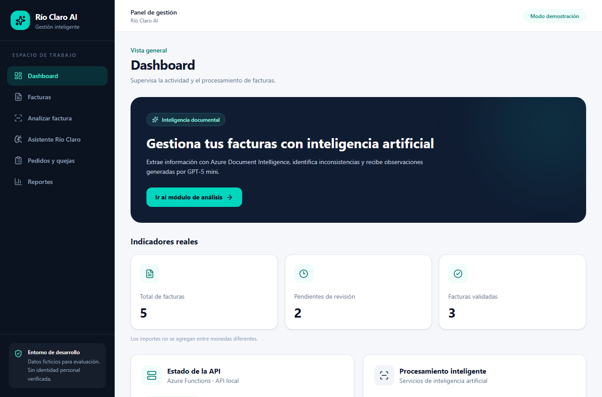
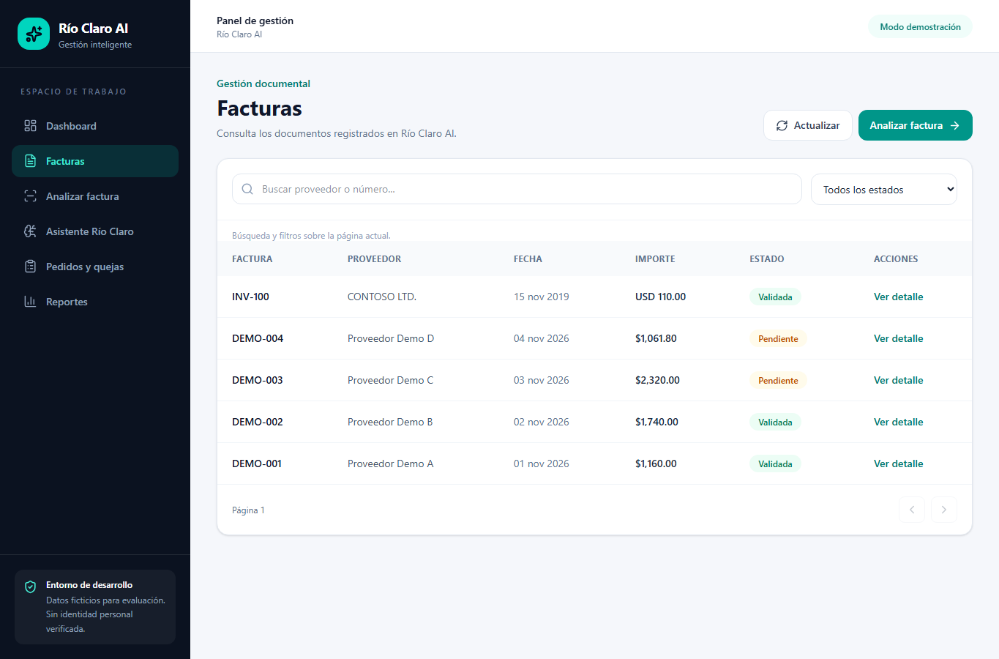
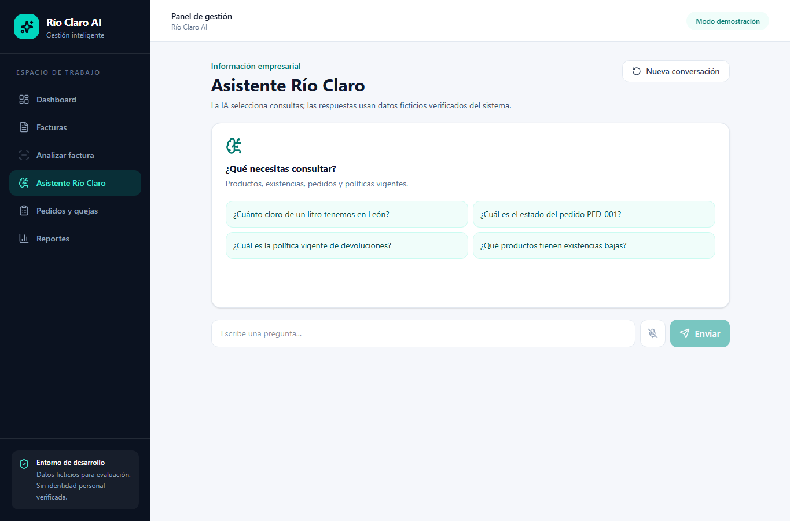
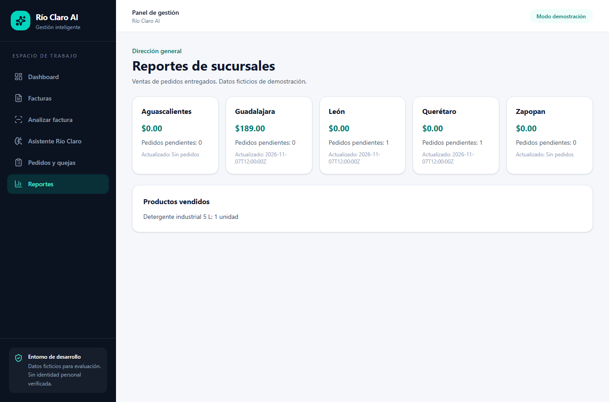
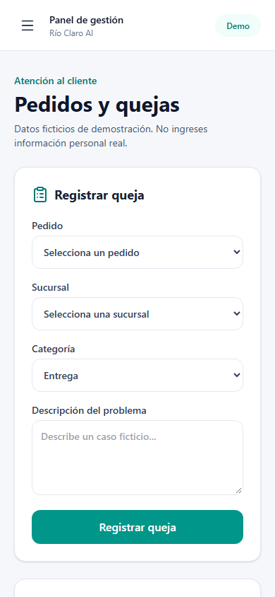
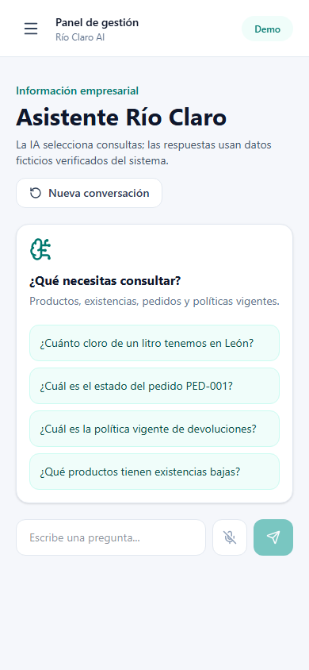

# Entrega académica — Río Claro AI

## 1. Información general

Río Claro AI es una demostración para Distribuidora Río Claro, empresa ficticia de productos de limpieza e higiene. Objetivo: reducir captura manual de facturas y facilitar consultas empresariales fundamentadas. **URL pública: pendiente; la aplicación aún no está desplegada.**

## 2. Diagnóstico inicial

Las facturas llegan por canales y formatos diferentes; capturarlas en hojas de cálculo dificulta detectar duplicados. Las sucursales usan nombres diferentes para productos y la información de pedidos, existencias y políticas está dispersa. Esa situación impide respuestas de IA verificables sin organizar los datos.

## 3. Solución desarrollada

**Facturas inteligentes:** PDF/imagen → Document Intelligence → validación matemática Python → comprobación de duplicados → observaciones de GPT-5 mini → persistencia → revisión humana. El backend rechaza importes faltantes; no los reemplaza con cero.

**Asistente empresarial:** GPT-5 mini elige una consulta de un conjunto cerrado; el backend valida argumentos, lee datos ficticios organizados y construye la respuesta con fuentes. También existen registro de quejas con folio y reportes calculados desde pedidos.

## 4. Arquitectura

React/Vite, Azure Functions Python v2 local, SQLite local, Azure Document Intelligence `prebuilt-invoice` y Azure OpenAI con despliegue `gpt-rioclaro` (GPT-5 mini). La infraestructura pública propuesta incluye Static Web Apps, Functions y almacenamiento Azure persistente; **no está creada**. Véase [arquitectura](docs/ARQUITECTURA.md).

## 5. Facturas inteligentes

El sistema valida bytes, formato y tamaño (4 MB). Reserva SHA-256 antes de llamadas de IA para impedir reprocesar un documento idéntico; compara proveedor, número, fecha, importe y moneda para confirmar o advertir posible duplicado. La aprobación/rechazo requiere una acción humana explícita y queda en historial. Aún falta almacenar extracciones parciales de documentos borrosos y resolver reclamaciones de hash abandonadas tras fallos de proceso.

## 6. Asistente empresarial

Consulta productos, inventarios de las cinco sucursales, pedidos y política vigente. Las fuentes muestran tipo, ID y fecha de actualización cuando existe. Una pregunta sin datos verificables recibe una respuesta de falta de información. La interfaz mantiene mensajes durante la sesión; el backend no conserva conversaciones.

## 7. Personajes

| Persona | Escenario cubierto | Estado |
|---|---|---|
| Laura | Subir, analizar, detectar duplicados y revisar facturas | Local; OCR parcial pendiente. |
| Don Ernesto | Dashboard y reporte de sucursales | Local, datos ficticios declarados. |
| Mariana | Consultar pedido mediante asistente, registrar y seguir queja | Local; consulta de queja por folio. |
| Toño | Consultar existencias desde chat | Local; voz pendiente por Speech. |
| Carlos | Revisar secretos ignorados, cuotas, interruptores y logs | Controles locales; falta persistencia cloud y monitoreo. |

## 8. IA responsable

- **Equidad:** la misma consulta de inventario opera para las cinco sucursales; hay prueba parametrizada.
- **Confiabilidad y seguridad:** importes ausentes provocan error y no se inventan; duplicados aproximados pasan a revisión humana.
- **Privacidad y seguridad:** datos ficticios, claves fuera de Git, JWT conservado y bypass restringido a local; cuotas SQLite locales y límites de entrada.
- **Inclusión:** diseño responsivo; voz aún no disponible porque falta Azure Speech.
- **Transparencia:** interfaz distingue datos ficticios, reglas Python, selector de IA, fuentes y resultados no verificados.
- **Rendición de cuentas:** revisión guarda decisión, fecha, observaciones e identificador ficticio del evaluador. La demo anónima no acredita identidad real.

## 9. Pruebas

Ver [PRUEBAS.md](docs/PRUEBAS.md). La suite normal usa mocks para Azure y no implica conexión real a sus modelos.

## 10. Evidencia visual local

Las siguientes capturas fueron obtenidas de la aplicación React ejecutándose localmente contra Azure Functions local. **No demuestran una URL pública ni una respuesta real de IA.**

## 11. Costos y restricciones

Los recursos existentes son Azure OpenAI S0 y Document Intelligence F0. No se consultó facturación efectiva ni se creó infraestructura adicional. Antes de publicar se deben verificar precios y cuotas según la región y la oferta Azure for Students; véase [guía de despliegue](docs/DESPLIEGUE_AZURE.md). El piloto local tiene cuotas por día e interruptores para análisis y chat.

## 12. Limitaciones

SQLite no sirve como almacenamiento compartido de una Function App escalable. La demo pública, el procesamiento asíncrono, la voz y la captura parcial OCR están pendientes. Las cifras de ventas e inventario son ficticias. Se verificó un viewport emulado de 390 px sin desbordamiento en dos pantallas, pero no una URL externa ni un móvil físico.

## 13. Conclusión

La demostración local organiza documentos y datos empresariales para que la IA seleccione consultas respaldadas por fuentes, mientras las reglas deterministas y la revisión humana mantienen el control de las decisiones. Para evaluación mediante enlace faltan infraestructura persistente y pruebas externas.
