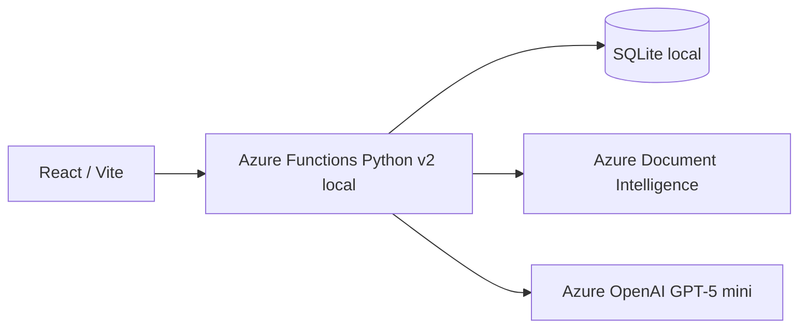
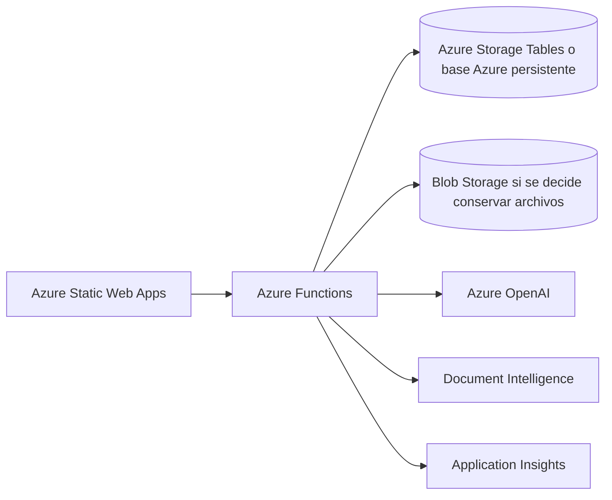

# Arquitectura actual y objetivo

## Actualmente implementada

El frontend usa Axios y TanStack Query. Facturas, análisis, revisiones, catálogo, inventario, pedidos, políticas, quejas y cuotas se guardan en SQLite local. El asistente usa Azure OpenAI para elegir una consulta permitida; el backend valida los argumentos, lee SQLite y construye la respuesta con fuentes. Los datos empresariales son ficticios.

El archivo original de factura no se persiste; solo se almacena su hash SHA-256 y resultados estructurados. Las operaciones de análisis y chat consumen una cuota diaria local mediante transacciones SQLite `BEGIN IMMEDIATE`. Los límites `DEV_` son independientes de `PROD_`; el día de cuota se reinicia a las 00:00 UTC. `GET /api/assistant/quota` permite consultar el saldo sin exponer secretos. En Azure Functions, SQLite se rechaza; Azure Tables permite un contador compartido mediante ETags, pendiente de prueba real. Véase [Cuotas](CUOTAS.md).

## Objetivo pendiente para publicación

**Actualización 2026-11-07:** la capa `STORAGE_BACKEND=table` está implementada y probada con un cliente falso. Conserva las consultas SQL actuales sobre una copia SQLite en memoria y persiste cada cambio en Azure Tables con ETags y transacciones de una partición. Los límites y la migración se explican en [Almacenamiento Azure](ALMACENAMIENTO_AZURE.md). Todavía falta una prueba real de identidad administrada, persistencia y reinicio en Azure; la demo pública sin login también sigue pendiente.

Esta arquitectura **no está desplegada**. Existe un adaptador y una migración hacia Azure Tables para datos, reservas de hash y cuotas; falta validarlos contra Azure real antes de publicar. El bypass `DEMO_MODE` actual solo sirve para desarrollo local. Una demo pública requiere un mecanismo separado con cuotas persistentes, permiso mínimo y operaciones costosas desactivables. La API no debe quedar abierta con capacidad de consumo ilimitado.

[Microsoft documenta el límite de 230 segundos para respuestas HTTP de Functions](https://learn.microsoft.com/en-us/azure/azure-functions/functions-scale). Si el análisis real lo supera, se necesita cola y consulta de estado; no basta aumentar el timeout de Axios.
